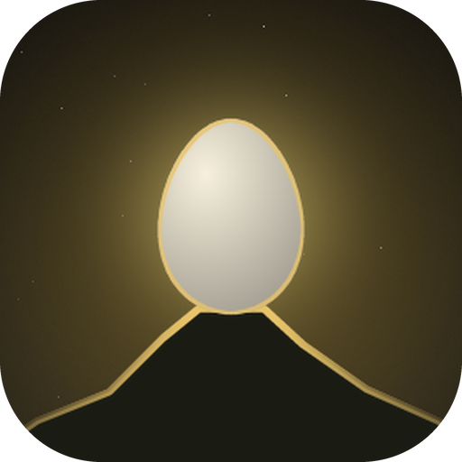
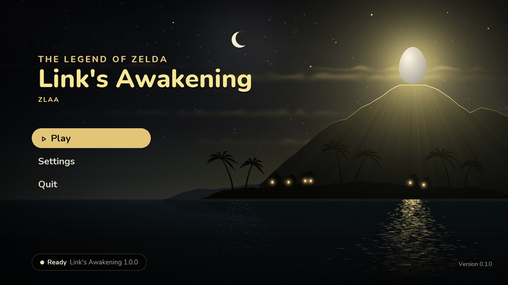
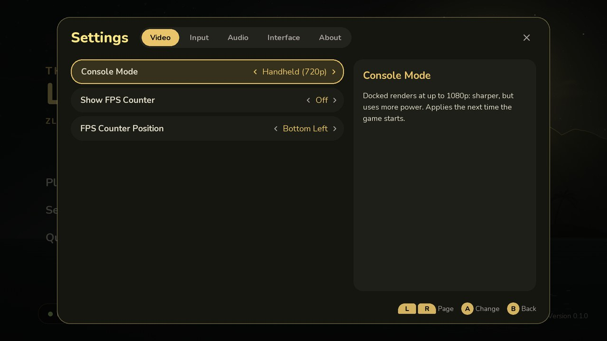

<div align="center">
  

  <h1>ZLAA</h1>

  <p align="center">
    <a href="../../releases">Download</a>
    •
    <a href="#getting-started">Getting started</a>
    •
    <a href="../../issues">Report a bug</a>
    •
    <a href="#building">Building</a>
  </p>
</div>

> [!IMPORTANT]
> **ZLAA was written with AI.** Almost every line of code and documentation here came from Claude Code (by Anthropic). I directed the project and its features, and tested each change on a real handheld. It began as a way to learn how a Switch game can be carried over to a different device, and it is shared in case it helps or entertains someone else. If AI-written software isn't something you want to use, that's completely fair, and this project probably isn't for you.

# Overview

ZLAA takes the Nintendo Switch version of *The Legend of Zelda: Link's Awakening* (2019) and turns it into a native Android app. It doesn't pretend to be a Switch. Instead, the game's own ARM64 machine code is converted into C once, compiled into a library for your device, and run on top of a small stand-in for the pieces of the Switch the game talks to: its operating system's services, and its NVN graphics API, redone on Vulkan. The game's GPU shaders are converted to SPIR-V the first time they're used and kept for next time.

All of it happens on the device: point ZLAA at your own game files, let it build the game once, then play.

```
your exefs ──► recompiler ──► C code ──► compiler ──► the game, as a native library
               (Python)                  (Zig)                          │
                                                                        ▼
your romfs ───────────────────────────────────────────────────────────► ZLAA ──► Vulkan, sound, controller
```

> [!NOTE]
> Made for **Android 11+ handhelds and phones** (arm64, Vulkan 1.3). So far it has only been tested on an **AYN Thor** (Snapdragon 8 Gen 2, Adreno 740). If you try another device, please say how it went.



## What you need

<table>
  <tr><td><b>Android</b></td><td>11 or newer, 64-bit (arm64-v8a)</td></tr>
  <tr><td><b>Graphics</b></td><td>Vulkan 1.3 (tested on the Adreno 740)</td></tr>
  <tr><td><b>Memory</b></td><td>8 GB or more (tested on 16 GB)</td></tr>
  <tr><td><b>Space</b></td><td>About 6 GB for your game files, 130 MB for the built game, and some room while it builds</td></tr>
  <tr><td><b>Controls</b></td><td>You currently need a controller to play this. Touch controls are planned for the future.</td></tr>
  <tr><td><b>Game</b></td><td>Your own copy of <i>Link's Awakening</i> v1.0.0, v1.0.1 or v1.1.0, as <code>exefs</code> and <code>romfs</code> folders</td></tr>
</table>

## Where it stands

ZLAA is young. The first areas of the game (Mabe Village, Toronbo Shores, Mysterious Forest, etc.) play at a steady 60 fps at 720p on the AYN Thor, with sound and the game's own dynamic resolution. Beyond that, little has been played yet, so expect surprises. If something breaks, please [open an issue](../../issues) and include your device, your game version and the app's `log.txt` (in `Android/data/io.github.zlaa/files/`). I'm currently playing through and will patch out any bugs I come across.

### Rough edges

- Once in a while (about 1 in 30 play sessions), the GPU stalls: a short freeze and a few broken frames, then the game carries on.
- Short hitches the first time a new effect appears, while its shader is prepared, and some stutter on the beach.
- Versions 1.0.1 and 1.1.0 pass tests, but only 1.0.0 has had long play sessions.

## What it does

**Plays like an Android game**

- Native ARM64 code and Vulkan graphics: no emulator in between.
- Handheld mode at 720p, or docked at 1080p.
- Press Home and the game pauses like a Switch would; come back and the pause menu is waiting.
- Movies play through Android's own video decoder.
- Every language the game has, including Japanese, Chinese and Korean (Settings › Interface › Game Language).
- Shaders are kept between sessions, so places you've been don't stutter again.

**Menus**

- A start screen and a pause menu on the Home/Mode button or Android's Back button.
- Settings for console mode, an FPS counter and its corner, Nintendo or Xbox button layout, stick dead zone, volume, skipping the start screen, and a note while shaders compile.



**Game Files**

- Any of the game's three releases: 1.0.0, 1.0.1 or 1.1.0.
- The game is built on your device from your files, at the pace you pick (Cool, Balanced or Fast), and the build takes a break whenever the device warms up.
- Your files are read where they are: nothing is copied, nothing is uploaded.

# Getting started

> [!IMPORTANT]
> ZLAA comes with **nothing** from the game: no code, art, music or fonts. You need your own legally obtained copy of *Link's Awakening*, extracted as its `exefs` and `romfs` folders. This project won't explain how to get them, and it will never ask you for keys or firmware.

### 1. Put your game files on the device

Copy the `exefs` and `romfs` folders into one folder in the device's main storage, for example `LADump/`.

### 2. Install ZLAA

Download `ZLAA.apk` from [Releases](../../releases) and open it on the device.

### 3. Show ZLAA your game

In ZLAA, open **Settings → Interface → Game Files**. Android asks for **All files access** (this lets ZLAA read the 6 GB where they are instead of copying them). Turn it on, then pick the folder from step 1. The start screen will show which game version it found.

### 4. Build the game

Choose **Build Game**. ZLAA converts your copy's code and compiles it for your device. This happens once per game version and takes about 55 minutes on the AYN Thor at the default **Balanced** speed. **Cool** runs cooler and takes about twice as long; **Fast** runs warmer. At any speed it pauses when the device gets too warm. Leave ZLAA open, plugged in if you can. If it gets closed, the build picks up where it stopped. Afterwards, **Settings → Interface → Free Up Space** clears what the build left behind.

What gets built stays on your device. It's made from your own files and never leaves it.

# FAQ

#### Is this an emulator?

No, this is a recomp project. An emulator reads the game's instructions one by one while you play. ZLAA converts all of them ahead of time (static recompilation).

#### Can I use an NSP or XCI file?

No. Those files are encrypted, and opening them needs keys from a console. ZLAA never asks for keys, so it only takes the already extracted `exefs` and `romfs` folders. I don't want to mess around with Switch keys, so it will be like this for the foreseeable future.

#### Can I build on a PC instead?

There's no player-friendly way yet, but I plan to implement this in the future.

#### Where are my saves?

In `/sdcard/Android/data/io.github.zlaa/files/save/`.

# Building

ZLAA builds on Linux (WSL works too). Everything made from the game (the generated C code and the built game) comes from your own files and must stay out of this repository.

```
pip install -r requirements.txt
python tests/run_tests.py                                   # recompiler tests (no game files needed)
python recompiler/recomp.py <your game>/exefs -o ~/zlaa-gen --no-comments
```

- **Android app:** set up the Android NDK, SDL 3 and the menus' libraries as described in [tools/android/README.md](tools/android/README.md), then package the app with `tools/android/build_apk.sh` (signed with a debug key, or your own via `LAA_SIGN_KEYSTORE` and `LAA_SIGN_PASS_FILE`).
- **Desktop** (a development tool, not a way to play): `tools/build_ui_deps.sh desktop`, then `cmake -S . -B build -G Ninja -DGAME_GEN_DIR=$HOME/zlaa-gen`, `cmake --build build` and `build/laa_host <your game>/exefs`.
- **A game built on a PC:** copy its `libgame-<build id>.so` into `/sdcard/Android/data/io.github.zlaa/files/game/` and ZLAA uses it instead of Build Game.

# Credits

**Built with**

- [SDL 3](https://libsdl.org) for the window, controller and sound
- [RmlUi](https://github.com/mikke89/RmlUi) and [FreeType](https://freetype.org) for the menus and their text
- [Nunito](https://github.com/googlefonts/nunito) and [Material Symbols](https://github.com/google/material-design-icons) for the menus' lettering and icons
- [Noto Sans CJK](https://github.com/notofonts/noto-cjk) (SC, TC, KR, JP) for the game's Chinese, Korean and Japanese text
- [Python](https://www.python.org) and [Zig](https://ziglang.org), which build the game on your device
- The [SPIR-V headers](https://github.com/KhronosGroup/SPIRV-Headers) from the Khronos Group (`runtime/render/shader/spirv`)
- [Capstone](https://www.capstone-engine.org), [Unicorn](https://www.unicorn-engine.org), [pyelftools](https://github.com/eliben/pyelftools) and [python-lz4](https://github.com/python-lz4/python-lz4) in the recompiler and its tests
- [libvpx](https://chromium.googlesource.com/webm/libvpx) for movies in the desktop build

# Legal

ZLAA is an unofficial fan project with no connection to Nintendo, and Nintendo has neither approved nor supported it. *The Legend of Zelda* and *Link's Awakening* are Nintendo's trademarks. Nothing from the game is in this repository or in any ZLAA download: to play, you need your own legally obtained copy.

# License

ZLAA's own code is free to use under the [MIT License](LICENSE). Code from other projects keeps its own license.
